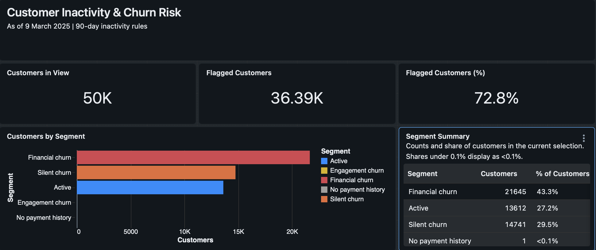
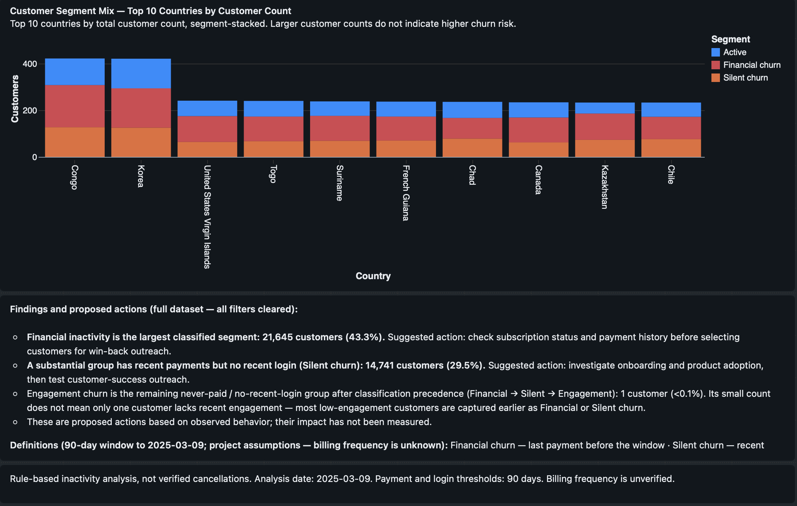

# SaaS Customer Churn & Retention Risk Analysis

**50,000 customers · Databricks SQL · Customer segmentation · Dashboard reporting**

Which customers should a customer-success team investigate first: those who stopped paying, or those who still pay but no longer log in?

This portfolio case study uses transaction and login history to classify customers as of **9 March 2025**. It extends a guided SQL tutorial with explicit date boundaries, corrected classification precedence, missing-history handling, and a Databricks dashboard.

## Findings and business decisions

| Segment | Customers | Share of customers | Proposed next step |
|---|---:|---:|---|
| Financial churn | 21,645 | 43.290% | Verify subscription and payment status before win-back outreach. |
| Silent churn | 14,741 | 29.482% | Investigate product adoption and test customer-success outreach. |
| Active | 13,612 | 27.224% | Use as a comparison group for further behavioral analysis. |
| No payment history | 1 | 0.002% | Check whether this is a trial user or a missing payment record. |
| Engagement churn | 1 | 0.002% | Investigate the remaining customer with no payment history and no recent login. |

**36,387 customers (72.774%, rounded to 72.8%) meet an inactivity flag.** This is a snapshot share under the project's rules—not a measured cancellation rate. Suggested interventions have not been tested, and no retention or revenue uplift is claimed.

The small Engagement segment is a consequence of mutually exclusive classification: most customers without recent logins already fall under Financial or Silent churn. It does not mean only one customer is disengaged.

## How the analysis works

1. Fix the observation date at `2025-03-09` so historical results do not change with the day the query runs.
2. Find each customer's last recorded payment and last `Login` event on or before that date.
3. Aggregate each source to one row per customer before joining it to the customer table.
4. Apply the segment rules below, then reconcile customer counts and percentages.
5. Present the results with segment and country filters, a customer detail view, and proposed actions.

| Rule, evaluated in order | Segment |
|---|---|
| Last payment before `2024-12-09` | Financial churn |
| Payment on/after the cutoff, but login before it or absent | Silent churn |
| No qualifying payment history, and login before the cutoff or absent | Engagement churn |
| No qualifying payment history, but a recent login | No payment history |
| Recent payment and recent login | Active |
| Anything unmatched | Needs review |

“Recent” includes the cutoff date and analysis date. The cutoff is `DATE_SUB(DATE '2025-03-09', 90)`. Both endpoints are included in this date-based implementation; it therefore spans 91 calendar date labels. The 90-day lookback threshold follows the tutorial and is an assumption, not a verified billing interval.

## SQL and reproducibility

- [Customer classification](01_customer_classification.sql)
- [Segment summary and flagged percentage](02_summary.sql)
- [Source-data and reconciliation checks](03_validation.sql)
- [Observed results](segment_summary.csv) and [validation evidence](validation.md)

Import the tutorial data into `analysis.churn_rate_analysis` in Databricks. The required columns are documented in [data and methods](data-and-methods.md). Run SQL files **01 → 02 → 03 in the same SQL session**, or concatenate them into a single script. File 01 creates a temporary view; source tables are unchanged. Adjust the catalog/schema names if your environment differs.

The result CSV is a transcription of the query output shown in the validation screenshot. Source customer records are not included in this repository.

## Dashboard

The overview answers how many customers are flagged and which segments dominate. Customer Detail supports further investigation by segment and country. The country chart shows customer volumes, not a ranking of country churn rates.

The checked-in images capture the dashboard. This repository does not include an importable dashboard configuration; the SQL reproduces the classification and summary, not the dashboard's full layout or country widgets.

## What I changed from the guided project

- Replaced `CURRENT_DATE` with a fixed historical analysis date.
- Matched the source event label `Login` and kept other events out of last-login calculations.
- Evaluated Silent before Engagement so the more specific paying-but-inactive group remains visible.
- Aggregated payments and logins separately to avoid multiplying records through raw joins.
- Used explicit Active and missing-history conditions instead of labeling every unmatched customer Active.
- Reconciled the corrected SQL output with the dashboard's five segment counts.

## Limitations

This is an educational dataset and a rule-based snapshot. Billing frequency, transaction success status, currency, and complete history coverage have not been established. Missing dated records are not proof that an event never happened. The rules do not incorporate subscription cancellations, customer tenure, or a minimum observation period, and they do not identify why a customer became inactive. A period churn rate would require a defined starting customer population and observed churn events during that period.

The packaged diagnostic queries are provided for rerunning on the source data; not all source-level checks have been executed. See [validation evidence](validation.md) for the precise scope of verification.

## Credit

Based on Haris Naeem's [SaaS Churn Analysis with SQL: Detect Customer Churn & Boost Retention](https://www.youtube.com/watch?v=w7JpYFN6b88). Obtain the source dataset through the tutorial's resources; it is not redistributed here. The tutorial supplies the initial business problem and 90-day approach. The analysis was adapted to Databricks SQL, and Databricks Genie assisted with dashboard construction; AI assistance also supported SQL review and repository documentation.

**Author: Simarjit Singh**
