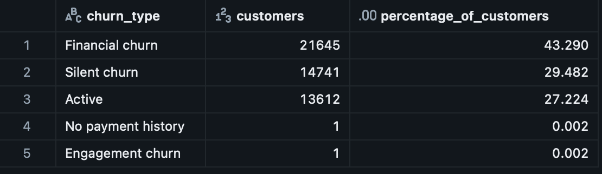

# Validation evidence

## Observed in Databricks

The author ran the corrected classification and summary query on 5 October 2026. The screenshot below shows the five resulting segment counts and percentages. These match the latest dashboard summary.

| Check | Evidence / status |
|---|---|
| Segment counts reconcile | 21,645 + 14,741 + 13,612 + 1 + 1 = 50,000 |
| Flagged count | Financial + Silent + Engagement = 36,387 |
| Flagged percentage | 36,387 / 50,000 × 100 = 72.774%, displayed as 72.8% |
| Shares reconcile | Displayed three-decimal percentages sum to 100.000% |
| Needs review | No such segment returned in the supplied result |
| Dashboard agreement | The five segment counts match the dashboard's reported results |

The published classification wraps that reviewed logic in a temporary view and omits names/emails from output. It has not been rerun against Databricks during repository packaging.

## Checks supplied for rerunning

`03_validation.sql` checks unique/null customer IDs, missing source dates, and exact expected segment counts. These diagnostic checks are not presented as completed source-data validation. Summary totals alone cannot establish record-level accuracy or uniqueness.

## Earlier dashboard difference

An earlier dashboard reported 36,380 flagged customers; the corrected output reports 36,387. The current query and dashboard reconcile, but the seven-record historical difference has not been traced to customer-level changes. Precedence alone would redistribute segments without changing the union of flags. Missing-history handling and other query edits must be compared against a preserved prior version before assigning a cause.

## Data publication

Only aggregate results and dashboard overview images are included. Raw customer records, names, emails, and customer-detail screenshots are excluded. Dataset redistribution rights have not been established; obtain source files through the credited tutorial.
